<!--
  Profile README for github.com/sudeshkar
  The header and every activity panel are SVGs generated by
  .github/workflows/profile-cards.yml and committed into assets/.
  See "How this page is built" at the end.
-->

<p align="center">
  <picture>
    <source media="(prefers-color-scheme: dark)" srcset="assets/header-dark.svg">
    <source media="(prefers-color-scheme: light)" srcset="assets/header-light.svg">
    
  </picture>
</p>

<p align="center">
  <a href="https://portfolio-v3-chi-cyan.vercel.app/"><b>Portfolio</b></a>
  &emsp;
  <a href="https://www.linkedin.com/in/sathieskumar-sudeshkar"><b>LinkedIn</b></a>
  &emsp;
  <a href="mailto:sudeshkar008sk@gmail.com"><b>Email</b></a>
  &emsp;
  <a href="https://medium.com/@sudeshkar008sk"><b>Medium</b></a>
  &emsp;
  <a href="https://portfolio-v3-chi-cyan.vercel.app/Sathieskumar_Sudeshkar_CV.pdf"><b>CV</b></a>
  &emsp;
  <a href="https://leetcode.com/u/sudeshkar/">LeetCode</a>
  &emsp;
  <a href="https://www.geeksforgeeks.org/profile/sudeshkah7lq">GeeksforGeeks</a>
</p>

<br>

I spend most of my day on the server side: **Java 21 and Spring Boot**, **C# and ASP.NET Core**, and the **React and TypeScript** interfaces that sit on top of them. I'm a Full Stack Developer Trainee at **Variosystems**, building internal business tooling in Blazor WebAssembly, and I graduated from **Cardiff Metropolitan University** in December 2025 with a BSc (Hons) in Software Engineering, Second Class Upper.

Outside work I fix things in **[OpenMRS](https://openmrs.org)**, the open-source medical record system that health services in more than 40 countries run on. Eleven of those fixes have been merged so far.

What I care about: layered architecture, REST APIs that are boring to consume, and concurrency bugs caught by a test rather than by a customer.

<p align="center">
  <picture>
    <source media="(prefers-color-scheme: dark)" srcset="assets/stats-dark.svg">
    <source media="(prefers-color-scheme: light)" srcset="assets/stats-light.svg">
    
  </picture>
</p>

## Merged into OpenMRS

Every change below went through OpenMRS code review and was merged upstream. Newest first.

| Merged | Pull request | What changed |
| :--- | :--- | :--- |
| Oct 2026 | [`stock-management` #683](https://github.com/openmrs/openmrs-esm-stock-management-app/pull/683) | The stock management dashboard no longer runs off the screen on tablets |
| Oct 2026 | [`patient-management` #2823](https://github.com/openmrs/openmrs-esm-patient-management/pull/2823) | Home dashboards stay inside a tablet screen, so their action buttons can be reached |
| Oct 2026 | [`laboratory` #878](https://github.com/openmrs/openmrs-esm-laboratory-app/pull/878) | The lab worklist reads every page of orders, not just the first 50 |
| Oct 2026 | [`patient-chart` #3793](https://github.com/openmrs/openmrs-esm-patient-chart/pull/3793) | The free-text dosage toggle says On when it is on |
| Sep 2026 | [`form-engine-lib` #816](https://github.com/openmrs/openmrs-esm-form-engine-lib/pull/816) | The remove button on attachment thumbnails is visible on light images and stays in its corner |
| Aug 2026 | [`patient-chart` #3525](https://github.com/openmrs/openmrs-esm-patient-chart/pull/3525) | Vitals and Biometrics tables sort in the direction the header arrow points |
| Aug 2026 | [`openmrs-core` #6391](https://github.com/openmrs/openmrs-core/pull/6391) | Entity UUIDs come from `java-uuid-generator`: 539.8 ns down to 5.9 ns per UUID at 32 threads |
| Jun 2026 | [`patient-management` #2521](https://github.com/openmrs/openmrs-esm-patient-management/pull/2521) | Strict equality (`eqeqeq`) is enforced across the module |
| Jun 2026 | [`esm-core` #1734](https://github.com/openmrs/openmrs-esm-core/pull/1734) | The Login Location tag filter in `useLocationCount` applies correctly |
| Jun 2026 | [`template-app` #255](https://github.com/openmrs/openmrs-esm-template-app/pull/255) | Clearer setup instructions for new contributors |
| Apr 2026 | [`admin-tools` #250](https://github.com/openmrs/openmrs-esm-admin-tools/pull/250) | README fix |

## Selected work

<table>
<tr>
<td width="50%" valign="top">

### [Jev corrective RAG](https://github.com/sudeshkar/jev-corrective-rag)

A corrective RAG pipeline where the yes/no decisions (is this question answerable, is this passage relevant, is this answer grounded) are typed Jev calls instead of an LLM judge. The LLM is only asked to write the answer.

`Python` `BM25` `Groq` `Streamlit`

- About 7x fewer LLM calls than the LLM-judge baseline
- Many questions are settled before they reach the generative model
- A Streamlit inspector shows each gate's verdict for every question

[Write-up](https://www.linkedin.com/posts/sathieskumar-sudeshkar_rag-llm-aiengineering-activity-7507462983028125696-xYVL)

</td>
<td width="50%" valign="top">

### [FreshLink](https://github.com/sudeshkar/FreshLink-Backend)

A B2B marketplace that replaces phone-and-WhatsApp fish ordering between suppliers and cafés in Kandy.

`Java 21` `Spring Boot 4` `PostgreSQL` `Redis` `React` `TypeScript`

- Optimistic locking on stock, proven by a test where two 60 kg orders against 100 kg would otherwise both succeed
- A matching engine that ranks supply by freshness, then supplier reliability
- 54 documented endpoints, rotating refresh tokens, 99 tests against real PostgreSQL and Redis in CI

[Frontend](https://github.com/sudeshkar/FreshLink-Frontend) &emsp; [Write-up](https://medium.com/@sudeshkar008sk/i-got-to-the-fish-market-too-late-so-i-built-a-backend-ca8b8b8d623e)

</td>
</tr>
<tr>
<td width="50%" valign="top">

### [Smart Waste Management](https://github.com/sudeshkar/wastemanagement)

A municipal waste platform for Sri Lanka, built by a team of four: bin sensor ingestion, route planning, driver assignment and citizen requests.

`Java` `Spring Boot` `React` `JWT`

- 88 REST endpoints across 20 controllers
- Role-based dashboards behind JWT authentication
- Persistence kept separate from presentation through service interfaces

[Frontend](https://github.com/sudeshkar/SMW_frontend)

</td>
<td width="50%" valign="top">

### [AI focus assistant](https://github.com/sudeshkar/AI-Powered-Focus-Assistant)

My final-year project: a desktop app that learns when you lose focus and suggests breaks to match.

`C#` `WPF` `Python` `Q-learning`

- A Q-table agent trained on six behaviour metrics
- The Python model talks to the WPF app over IPC in under 200 ms per cycle
- MVVM throughout, so the policy can change without touching the UI

</td>
</tr>
</table>

## Toolkit

| | |
| :--- | :--- |
| **Languages** | Java, C#, TypeScript, JavaScript, Python, SQL |
| **Backend** | Spring Boot, Spring Security, Spring Data JPA, ASP.NET Core, REST API design, JWT and OAuth2 |
| **Frontend** | React, Blazor WebAssembly, Tailwind CSS, Carbon Design System |
| **Data** | PostgreSQL, MySQL, SQL Server, Redis, pandas, scikit-learn |
| **Tooling** | Git, Docker, GitHub Actions, Maven, Postman, Google Cloud |

## Experience

**Full Stack Software Developer Trainee**, Variosystems
<br><sub>February 2026 to now</sub>

Internal workspace tooling in Blazor .NET WebAssembly with MVVM, from the components through to ASP.NET Core services and data access. Three internal workflows streamlined and two feature modules shipped on schedule.

**Open Source Contributor**, OpenMRS
<br><sub>January 2026 to now</sub>

Eleven merged pull requests across nine repositories, from the Java core to the O3 React micro-frontends: lab orders, dashboards, medication forms, patient charts and login.

**BSc (Hons) Software Engineering, Second Class Upper**, Cardiff Metropolitan University
<br><sub>Graduated December 2025</sub>

## Activity

<p align="center">
  <picture>
    <source media="(prefers-color-scheme: dark)" srcset="assets/languages-dark.svg">
    <source media="(prefers-color-scheme: light)" srcset="assets/languages-light.svg">
    
  </picture>
  <picture>
    <source media="(prefers-color-scheme: dark)" srcset="assets/rhythm-dark.svg">
    <source media="(prefers-color-scheme: light)" srcset="assets/rhythm-light.svg">
    
  </picture>
</p>

<p align="center">
  <picture>
    <source media="(prefers-color-scheme: dark)" srcset="assets/activity-dark.svg">
    <source media="(prefers-color-scheme: light)" srcset="assets/activity-light.svg">
    
  </picture>
</p>

## Writing

**[Jev, and the RAG decisions that never needed an LLM](https://www.linkedin.com/posts/sathieskumar-sudeshkar_rag-llm-aiengineering-activity-7507462983028125696-xYVL)**
<br>A corrective RAG loop makes six yes/no calls per question. I moved them off the LLM and left it the one job it was needed for: 0.75 LLM calls per question.

**[I Got to the Fish Market Too Late. So I Built a Backend.](https://medium.com/@sudeshkar008sk/i-got-to-the-fish-market-too-late-so-i-built-a-backend-ca8b8b8d623e)**
<br>How a late Sunday in Kandy became FreshLink, and the concurrency bugs, IDOR fixes and rollback surprises that 99 tests caught.

**[Building a Serverless REST API with Google Apps Script and Google Sheets](https://medium.com/@sudeshkar008sk/building-a-serverless-rest-api-with-google-apps-script-and-google-sheets-568567b3a905)**
<br>The backend that still feeds the project list on my portfolio.

<details>
<summary><b>How this page is built</b></summary>

<br>

The header and every panel are SVG files in [`assets/`](assets), rendered by [`scripts/generate-cards.mjs`](scripts/generate-cards.mjs) and committed by [a scheduled workflow](.github/workflows/profile-cards.yml) every six hours.

Shared card services such as `github-readme-stats` run on one public rate limit. When it runs out, the card returns an error, GitHub's image proxy caches it, and the panel stays empty for hours. Doing the work at build time avoids that:

| Step | What happens |
| :--- | :--- |
| Fetch | `scripts/data.mjs` queries the GitHub GraphQL API with this repository's own `GITHUB_TOKEN` |
| Fall back | The result is saved to `assets/data.json`. If a run fails, the panels are drawn from the last good copy |
| Render | `scripts/cards/*.mjs` write a light and a dark SVG for each panel. Archivo, the typeface from my portfolio, is embedded in each file, so it renders the same everywhere |
| Serve | The SVGs live in this repository, so viewing the page calls no outside service |

To run it locally:

```bash
GITHUB_TOKEN=$(gh auth token) node scripts/generate-cards.mjs
```

</details>

<br>

<p align="center">
  <b>Open to full-stack and backend software engineering roles, remote or in Sri Lanka.</b>
  <br>
  <a href="mailto:sudeshkar008sk@gmail.com">sudeshkar008sk@gmail.com</a>
</p>
